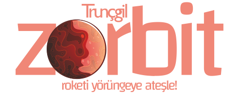

<p align="center">
  
</p>

# Zorbit

Dönen gezegenlerin yörüngesinden roketi doğru zamanlamayla bir sonraki gezegene fırlatarak ilerlenen, **TypeScript + PixiJS v8 (WebGL) + Vite** tabanlı 2D arcade oyunu.

Canlı sürüm: **[zorbit.truncgil.com](https://zorbit.truncgil.com/)**

---

## Teknoloji Yığını

| Katman | Teknoloji | Açıklama |
| :--- | :--- | :--- |
| **Dil & Derleme** | TypeScript 5.7, Vite 6 | Strict tip güvenliği, hızlı HMR ve üretim derlemesi (`__APP_VERSION__`, `__APP_VERSION_CODE__` enjeksiyonu) |
| **Görüntüleme (Render)** | PixiJS v8 (WebGL2 / WebGPU) + Canvas 2D Fallback | Katman bazlı `SpriteLayerPool` ile sıfır bellek tahsisli GPU çizimi; WebGL desteklenmeyen ortamlarda otomatik `CanvasRenderer` yedeği |
| **Asset Yönetimi** | PixiJS `Assets` Manifest & Bundle | `core` bundle yüklemesi ve spritesheet alt-texture dilimleme |
| **Ses** | Web Audio API | Orijinal `.ogg` ses efektleri ve sessize alma (`mute`) desteği |
| **Arayüz** | Responsive HTML5 / CSS3 (`9:16` ölçekli) | Parça birleşimli SVG Trunçgil açılış introsu, animasyonlu tam ekran Skor Tablosu, oyuncu adı düzenleme ve yumuşak ekran geçişleri |
| **Test** | Vitest 2 | DOM'dan bağımsız çekirdek oyun sistemleri için birim testleri |
| **Dağıtım & Yayın** | `release.bat` + `scripts/release.mjs` + Capacitor | Tek komutla versiyon/build artırma, Git tag, Web (`zorbit.truncgil.com`), Android (`.aab`), Windows (`.msix`) ve SSH üzerinden macOS TestFlight yayını |

---

## Nasıl Yapıldı? (Mimari & Tasarım)

Proje **SOLID prensiplerine** uygun olarak 3 katmana ayrılmıştır; oyun çekirdeği tarayıcı ve DOM'dan tamamen bağımsızdır:

- **`src/core/` (Oyun Çekirdeği):**
  - `GameEngine`: Sabit zaman adımlı (`dt`) oyun döngüsü, durum geçişleri (`loading → menu → playing → gameover`) ve `gameover` anında dokunma/`Space` ile anında menüye dönüş.
  - `OrbitSystem` & `FlightSystem`: Yörünge dönüşü, fırlatma fiziği, boşluğa atışta erken ıskalama tespiti (`FLIGHT_MIN_MISS_CHECK_SEC: 0.25s`) ve `1.2s` uçuş zaman aşımı.
  - `CollisionSystem` & `SpawnSystem`: Dairesel çarpışma kontrolü, rastgele konum/boyutta yeni gezegen üretimi ve geçmiş gezegenlerin temizlenmesi.
  - `DifficultySystem`: İniş yaptıkça artan gezegen dönüş hızı (`80°/s → 210°/s`), roket hızı (`1600 → 2200 px/s`) ve `50` skor sonrası aktif gezegenin solma (`fade`) mekaniği.
  - `CameraSystem`: Yörüngedeyken uzaklaşan (`0.65x`), uçuşta yakınlaşan (`1.2x`) yumuşak kamera takibi ve çarpışma sarsıntısı.
  - `ParticleSystem`: Arka plan yıldızları, roket izi, parçacık patlamaları ve `+3` / `-3` skor pop-up efektleri.
- **`src/core/interfaces/` (Soyutlamalar):**
  - `IRenderer`, `IAudioPlayer`, `IInputProvider`, `IScoreRepository`, `IRandomProvider`.
- **`src/infrastructure/` (Platform Adaptörleri):**
  - `render/`: `PixiRenderer` (WebGL + `SpriteLayerPool`), `CanvasRenderer` (2D fallback), `AssetManifest`, `RendererFactory`.
  - `input/`: `BrowserInputProvider` (dokunma, fare, `Space`, `Yukarı Ok`).
  - `audio/`: `WebAudioPlayer`.
  - `storage/`: `LocalStorageScoreRepository` ve `LeaderboardService` (uzak API erişilemezse yerel kayda düşen esnek istemci).
- **`src/ui/` (Arayüz Katmanı):**
  - `UIManager`: Menü (`Space`/`Enter`/`Tab` ile başlatma), `vX.Y.Z (N)` versiyon bilgisi, benzersiz oyuncu adı modalı ve animasyonlu **Haftanın Zorbitleri / Önceki Haftalar** skor tablosu.

---

## Veri Yapısı (Data Structure)

Oyun çekirdeğindeki tüm durum ve varlıklar `src/core/state/`, `src/core/entities/` ve `src/core/config/` altında tanımlanır:

### `GameWorld` (`src/core/state/GameWorld.ts`)
Oyunun tek doğruluk kaynağı (single source of truth) olan ana durum kapsayıcısıdır:
- `phase: GamePhase` — `'loading' | 'menu' | 'playing' | 'gameover'`
- `score: number` / `bestScore: number` / `isNewBest: boolean` — Anlık skor, en yüksek skor ve rekor bayrağı
- `difficultyDeg: number` — Gezegen dönüş hızı zorluk seviyesi (`80°/s → 210°/s`)
- `flightTimerSec: number` — Uzayda boşlukta geçirilen süre
- `nextEntityId: number` — Artan varlık kimliği sayacı
- `planets: Planet[]` — Sahnedeki gezegenler
- `attachments: PlanetAttachment[]` — Gezegenlere bağlı ödül ve engeller
- `particles: Particle[]` — Görsel efekt parçacıkları
- `rocket: Rocket` — Oyuncu roketi
- `camera: CameraState` — Kamera durumu (`{ x, y, zoom, shakeIntensity }`)

### Temel Varlıklar (`src/core/entities/`)
- **`Planet`**: `id`, `x`, `y`, `radius`, `angleRad`, `rotationSpeedRad`, `active`, `opacity`, `isFadingOut`, `fadeDurationSec`
- **`Rocket`**: `x`, `y`, `angleRad`, `speed`, `pinnedPlanetId` (`number | null`), `orbitAngleRad`, `isFlying`, `opacity`, `isFadingOut`, `fadeDurationSec`
- **`PlanetAttachment`** *(soyut sınıf)* → **`PointItem`** (`kind: 'point'`, `+3` puan) ve **`EnemyItem`** (`kind: 'enemy'`, `-3` puan): `id`, `planetId`, `localAngleOffsetRad`, `orbitDistance`, `radius`, `x`, `y`, `angleRad`, `spinSpeedRad`, `collected`
- **`Particle`**: `kind` (`'star' | 'trail' | 'burst' | 'scorePopup'`), `x`, `y`, `vx`, `vy`, `scale`, `opacity`, `ageSec`, `lifetimeSec`, `angleRad`, `frame?` (`0 | 1`)
- **`Vector2` & `CircleBounds`**: Konum (`{ x, y }`) ve dairesel çarpışma sınırı (`{ x, y, radius }`)

### Kalıcı Veri & Liderlik (`src/infrastructure/storage/`)
- **`LocalStorageScoreRepository`**: En yüksek skoru tarayıcı `localStorage` üzerinde `score_zorbit` anahtarı ile saklar.
- **`LeaderboardService`**: Oyuncu kimliği (`zorbit_player_id`) ve benzersiz takma adı (`zorbit_username`) yönetir; `AppConfig.API_BASE_URL` (`https://zorbit.truncgil.com/api`) üzerinden `LeaderboardEntry` ve `WeeklyArchiveGroup` verilerini alır/gönderir.

---

## Kurulum ve Çalıştırma

```bash
npm install
npm run dev
```

### Testler ve Derleme

```bash
npm test        # Vitest birim testlerini çalıştırır
npm run build   # TypeScript kontrolü + Vite production build
```

### Tek Komutlu Release (`release.bat`)

`.env.release.example` dosyasını `.env.release` olarak kopyalayıp sunucu/mağaza bilgilerinizi girdikten sonra:

```bat
release.bat patch        :: version & versionCode artırır, test + build alır, tag atar ve tüm hedeflere yayınlar
release.bat minor        :: minor sürüm artırır
release.bat patch --dry-run
```

---

## Yol Haritası

- [x] **Faz 1:** Çekirdek oyun mekaniği, SOLID mimari, PixiJS WebGL renderer, preloader/menü animasyonları, birim testleri ve yerel skor kaydı
- [x] **Faz 1.5:** İstemci tarafı benzersiz oyuncu adı, Haftanın Zorbitleri / Önceki Haftalar arayüzü ve `release.bat` çoklu platform yayın hattı
- [ ] **Faz 2:** `truncgil_ubuntu` üzerinde Node.js + PostgreSQL + Redis backend API'si, oturum doğrulama, push notification ("seni geçti!" bildirimi) ve Microsoft Store / App Store / Google Play mağaza paketleri
